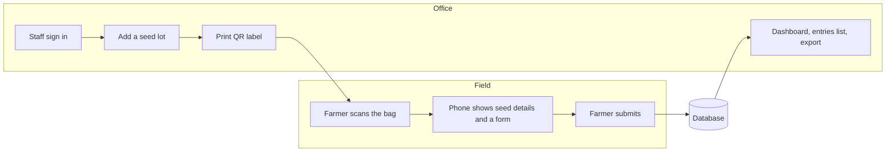

# SeedCode

SeedCode tracks which farmer received which seed. The office enters a seed
lot once and prints a QR label for its bags. A farmer scans a bag with their
phone camera, sees the seed details, and fills in a short form. The entry
arrives in the office, where staff can search, chart and export it.

Farmers install nothing and never sign in. Only office staff have accounts.

## How it works



1. **The office adds a seed lot** (crop, variety, batch number and so on).
   The app gives it a short ID such as `K7M2PQ4X`.
2. **The QR code holds only a link**, `https://<site>/f/K7M2PQ4X`. The seed
   details stay on the server, so they can be corrected later without
   reprinting labels.
3. **The farmer scans the bag.** The phone opens that link, loads the seed
   details and the form, and the farmer fills it in.
4. **The entry is saved on the phone first, then sent.** If there is no
   signal it waits on the phone and is sent when the signal returns. The
   phone gives each entry its own ID, so an entry sent twice is stored once.
5. **The office sees it** in the entries list and in the dashboard charts.

## The parts

| Part | What it is | Where |
|---|---|---|
| Frontend | React 19 + TypeScript, built with Vite. One app serves both the office pages and the farmer's form. | `frontend/` |
| Backend | A Python API built with FastAPI. It checks who is signed in, validates everything, and talks to the database. | `backend/` |
| Database | PostgreSQL in Docker; MySQL and SQLite also work. Holds lots, entries, form settings and staff accounts. | outside the repo |

In development there are two servers: Vite on port **5174** serves the pages
and passes every `/api/...` request on to the backend on port **8010**. In
production there is one: the backend serves the built frontend files itself,
so the whole site is a single Docker image.

## Pages

| Address | Who | What |
|---|---|---|
| `/f/:lotId` | Farmers, no sign-in | Seed details and the farmer form. Works offline once loaded. |
| `/` | Staff | Dashboard: entry counts, insights worked out from them, charts by crop, channel and hour of the week, latest entries. Refreshes itself while "Live" is on. |
| `/barcode` | Staff | Seed lots, QR labels, and (admins) the form questions. |
| `/users` | Staff | Farmer entries: search, date filter, export, Excel import. |
| `/staff` | Admins | Staff accounts and roles. |

Note the naming: the **Users** page lists *farmers who submitted the form*.
The people who sign in are on the **Staff** page.

On any office page, **Ctrl+K** (⌘K on a Mac) opens a search box: go to a
page, find a seed lot by crop, variety or batch, or search farmer entries.
On the Users page, **/** jumps to its search box.

## Roles

Every staff account has one role. The frontend hides what a role may not do,
but that is only for convenience: **the backend checks the role again on
every request**, so hiding a button is never what keeps data safe.

| | Viewer | Editor | Admin |
|---|:-:|:-:|:-:|
| See dashboard, seed lots, farmer entries | ✓ | ✓ | ✓ |
| See full ID numbers (Aadhaar, PAN) | last 4 digits | ✓ | ✓ |
| Add, change, delete seed lots | | ✓ | ✓ |
| Import entries from Excel, export all entries | | ✓ | ✓ |
| Change the form questions | | | ✓ |
| Add staff, change roles, reset passwords | | | ✓ |

The rules live in `backend/app/auth.py`.

## How signing in works

1. The sign-in page sends the username and password to `POST /api/login`.
2. The backend compares the password with a stored **hash** (argon2). The
   password itself is never stored.
3. If it matches, the backend makes a long random **token**, remembers it for
   12 hours, and returns it with the username and role.
4. The frontend keeps the token in `sessionStorage` and sends it with every
   request as `Authorization: Bearer <token>` (see `frontend/src/data/api.ts`).
5. A reply of **401** means "not signed in" and the frontend shows the
   sign-in page. A reply of **403** means "signed in, but your role may not
   do this".

Changing someone's role, switching their account off, or resetting their
password signs them out everywhere at once.

Wrong passwords are limited: after 10 from one address for one username in
15 minutes, that pair waits; one address trying many usernames, or many
addresses trying one, are stopped a little later. The reply is **429**, and
the sign-in page shows how long to wait.

## Folder map

```
backend/
  app/
    main.py        the API routes: lots, entries, forms, export, health
    auth.py        sign-in, roles, staff accounts
    stats.py       the dashboard's numbers, counted by the database
    cache.py       answers kept in memory until the data they came from changes
    limits.py      how often one address may try, and how much it may send
    forms.py       the questions on the two forms, which admins can change
    models.py      the database tables
    schemas.py     the JSON shapes sent and received
    migrate.py     brings the database up to date; makes the first admin
    config.py      settings read from backend/.env
    database.py    the database connection
  alembic/         the history of database changes ("migrations")
  tests/           67 automated tests of the API, its limits and its numbers
  run.py           starts the backend for development

frontend/src/
  pages/           one file per page: Dashboard, Barcode, Users, Staff,
                   SignIn, FarmerForm
  components/      charts, form inputs, layout, the Excel import
  data/api.ts      every call to the backend goes through here; keeps answers
                   so pages show at once, and asks again in the background
  data/insights.ts the dashboard's insights, worked out from its numbers
  data/outbox.ts   keeps a farmer's entry on the phone until it is sent
  data/types.ts    TypeScript types matching the backend's JSON
  config.ts        app name, department name, sign-in picture

Dockerfile             builds frontend + backend into one image
docker-compose.yml     runs that image with a PostgreSQL database
deploy/                nginx, backups and updates on the server (see its README)
.github/workflows/     tests and builds on every push
```

## The API

Every address starts with `/api`. Every failure comes back as
`{"error": "a message a person can read"}`.

| Method and path | Who | What |
|---|---|---|
| `POST /login`, `POST /logout` | anyone | Sign in and out |
| `GET /health` | anyone | "Is the app and its database up?" Used by Docker. |
| `GET /lots/{id}` | anyone | What a farmer's phone loads after scanning |
| `POST /entries` | anyone | A farmer submitting the form |
| `GET /lots` | any staff | All seed lots with their entry counts |
| `POST /lots`, `PUT /lots/{id}`, `DELETE /lots/{id}` | editor, admin | Add, change, delete a lot |
| `GET /entries?page=&size=&q=&from=&to=` | any staff | One page of entries, with the total |
| `POST /entries/import` | editor, admin | Rows from an Excel file |
| `POST /entries/export` | editor, admin | Every matching entry as a CSV file |
| `GET /stats?start=&days=&size=&tz=` | any staff | Everything on the dashboard, in one answer |
| `GET /forms` | any staff | The questions on both forms |
| `PUT /forms/{lot or farmer}` | admin | Change those questions |
| `GET /staff`, `POST /staff`, `PUT /staff/{id}` | admin | Staff accounts |

With `DOCS=true` in `backend/.env`, `http://localhost:8010/api/docs` shows
every route with a form to try it. It is off unless switched on, so a server
on the internet does not describe itself to strangers.

## The data

| Table | One row is | Notes |
|---|---|---|
| `seed_lots` | A batch of seed with one QR code | Deleting a lot hides it and stops its code working, but keeps the row. |
| `farmer_entries` | One submitted farmer form | Also stores details of the phone, and a copy of the seed details as the farmer saw them. |
| `form_settings` | The office's changes to one form | Renamed, hidden, optional and added questions. |
| `users` | A staff account | Username, password hash, role, on/off. |
| `admin_sessions` | One sign-in | A hash of the token, and when it expires. |

Answers to questions the office adds itself are stored in an `extra` column
as JSON, so adding a question never changes the tables.

## Built for a large number of entries

The target is about 5 lakh (500,000) farmer entries. Three things make that
workable:

- **The entries list is paged.** The Users page asks for 1,000 rows at a
  time, and search and date filters run in the database.
- **The dashboard asks for counts, not rows.** `GET /stats` returns a few
  hundred numbers however many entries there are, and the server keeps that
  answer until an entry or a lot changes. With 2 lakh entries it takes about
  a second to work out, then a few milliseconds while it is kept.
- **Searching does not read every entry.** On PostgreSQL, trigram indexes
  find part of a name, phone number or channel directly (migration 0004);
  the same seed lot is found by one indexed key, not by reading every lot.
- **Export is streamed.** "Export all" downloads a CSV that the server writes
  row by row, so no one has to hold every entry in memory.

## Running it

### Development (what we use day to day)

Backend, in `backend/`:

```sh
python -m venv .venv
.venv\Scripts\activate          # Windows;  source .venv/bin/activate elsewhere
pip install -r requirements.txt
copy .env.example .env          # then fill in ADMIN_USERNAME and ADMIN_PASSWORD
python run.py
```

Frontend, in `frontend/`:

```sh
npm install
npm run dev
```

Open http://localhost:5174 and sign in with the username and password from
`backend/.env`. Those two settings only create the first admin account; after
that, accounts are managed on the Staff page.

`python run.py` updates the database before starting. With no `DATABASE_URL`
in `.env` it uses a SQLite file, which needs nothing installed.

### Docker (how it is meant to run on a server)

```sh
copy .env.example .env          # fill in PUBLIC_URL, POSTGRES_PASSWORD, ADMIN_USERNAME, ADMIN_PASSWORD
docker compose up -d --build
```

Open http://localhost:8010. This starts three things: a PostgreSQL database,
a one-off step that updates the database, and the app. The app listens on
this computer only; on a server, nginx passes the world's requests on (see
`deploy/README.md`, which also covers backups and updates).

### Tests

```sh
cd backend
pip install -r requirements-dev.txt
pytest
```

The tests use their own temporary database and never touch the real one.

## Changing the database

Tables are never edited by hand. Each change is a small file in
`backend/alembic/versions/`, applied in order by `python -m app.migrate`
(which `run.py` and Docker both call). This is what lets the same change be
applied identically on every developer's machine and on the server.

## Continuous integration

`.github/workflows/ci.yml` runs on every pull request and every push to
`main`:

1. The backend tests, on SQLite and on PostgreSQL.
2. The frontend lint and build (which includes the TypeScript check).
3. A build of the Docker image. On `main` it is also published to GitHub's
   container registry.

## Where things stand

**Done and tested**

- Staff accounts, three roles, hashed passwords, limits on guessing them.
- Paged entries, server-side dashboard numbers kept until data changes,
  streamed export.
- Database migrations, tried on SQLite, PostgreSQL and MySQL.
- 67 backend tests, run on SQLite and PostgreSQL.
- Limits on how fast one address may use the public pages and how much it
  may send; safety headers (a content security policy among them) on every
  answer.
- Running at https://seed.skyquestinsights.com in Docker behind nginx, with
  nightly database backups and certificate renewal (see `deploy/README.md`).

**Still needed**

- Backups copied off the server, and a bigger disk for it.
- Error monitoring, so a failure is noticed before the office reports it.
- Confirmation of the rules for storing Aadhaar and other ID numbers.

## Words a frontend developer may not use every day

| Word | Meaning here |
|---|---|
| **Endpoint / route** | One address the backend answers, such as `GET /api/lots`. |
| **Token** | The random string that proves a request comes from someone signed in. |
| **Hash** | A one-way scramble of a password. It can be checked but not reversed. |
| **RBAC** | Role-based access control: what you may do depends on your role. |
| **Migration** | A recorded, repeatable change to the database's tables. |
| **Pagination** | Sending a long list a page at a time instead of all at once. |
| **Docker image** | The app and everything it needs, packed so it runs the same anywhere. |
| **Docker Compose** | A file that starts several containers together (here: app + database). |
| **CI** | Automatic tests and builds that run on every push. |
| **Health check** | An address that answers "I am working", so a broken copy can be restarted. |
